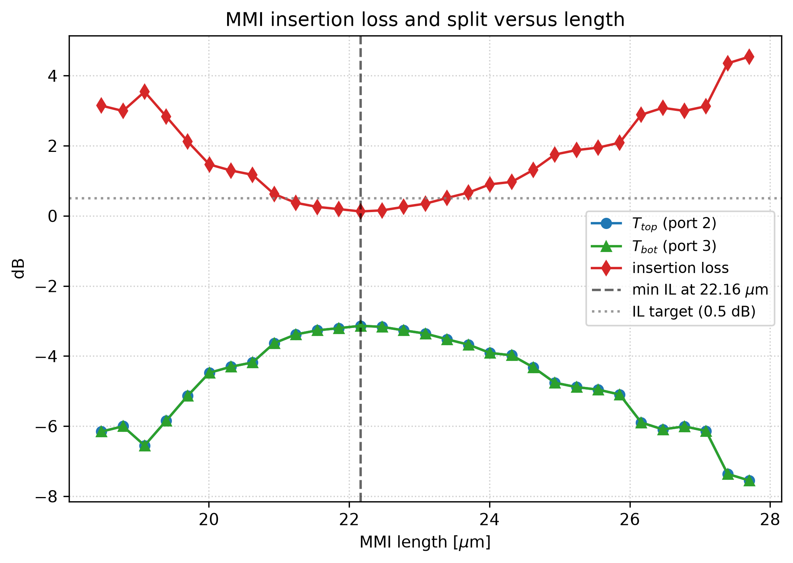
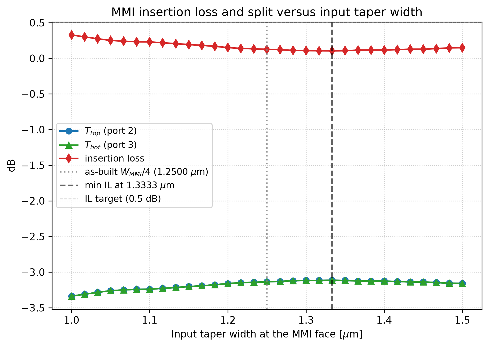
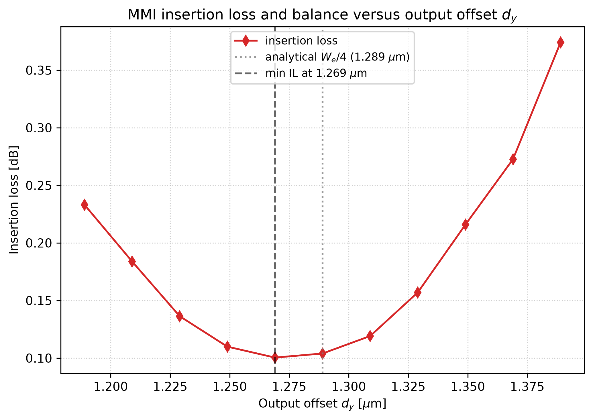
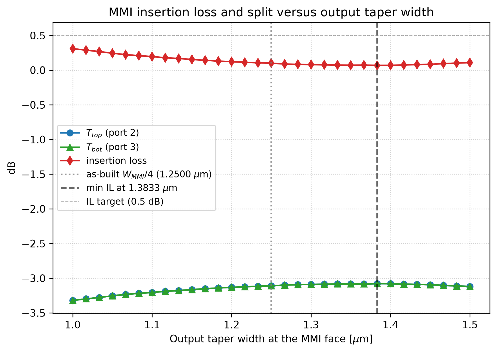
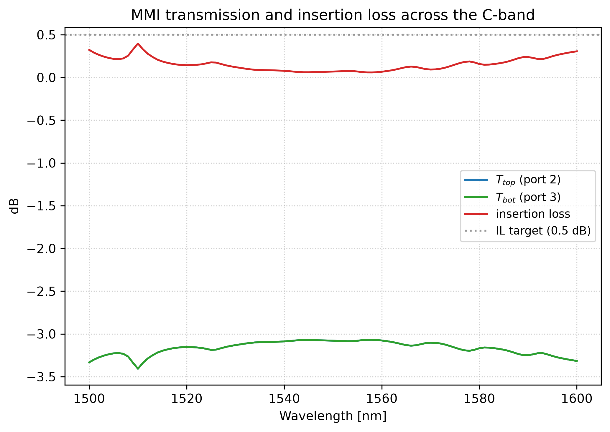
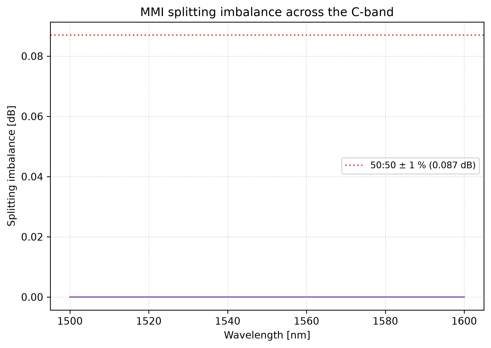

# 1×2 MMI Splitter, Design and Optimization

Self-imaging 1×2 multimode interferometer, used as the 50/50 splitter and combiner of the
MZI. Designed in Lumerical **MODE** using the **EME** (eigenmode expansion) solver.

| Target             | Value                    |
| ------------------ | ------------------------ |
| Splitting ratio    | 50:50 ± 1 %              |
| Insertion loss     | < 0.5 dB                 |
| Bandwidth          | > 40 nm around 1550 nm   |
| Phase between outputs | 0 (in-phase)          |

## Design point

| Parameter | Value |
| --------- | ----- |
| MMI width `W_MMI` | 5.0 µm |
| Effective width `W_e` | 5.156 µm |
| MMI length `L_MMI` | **22.162 µm**, from the length sweep; 23.085 µm from the FDE-refined beat length, 29.82 µm from the slab formula |
| Output offset `d_y` | **1.2690 µm**, from the `d_y` sweep; `W_e/4 = 1.2890 µm` analytically |
| Output separation | 2·`d_y` = 2.538 µm |
| Tapers | linear, 0.5 → `W_MMI/4` = 1.25 µm as built; 8 µm input, 5 µm output |
| Lead waveguides | 10 µm, both sides |

`W_MMI` is set in `step02_mmi_design.lsf`, and every sweep below is run on that body. The taper end
width is not an independent constant there: it is tied to the body as `W_MMI/4`, so that the
taper-to-body ratio stays fixed when the width changes. That tie is a starting point rather than a
result, which is what the two taper-width sweeps are for, and both move it wider, to 1.3333 µm on
the input and 1.3833 µm on the output.

## Why an MMI rather than a directional coupler

MMIs are broadband (self-imaging depends on mode beating rather than evanescent coupling),
tolerant to fabrication error (no critical gap dimension to control), and give better
splitting uniformity.

## Design equations

For a symmetric, centered-input 1×2 general-interference MMI:

| Quantity | Expression | Meaning |
| -------- | ---------- | ------- |
| Effective width | `W_e = W_MMI + (λ/π)·(n_c/n_r)^(2σ)/√(n_r²−n_c²)` | Goos–Hänchen correction; σ = 0 for TE |
| Beat length | `L_π = 4 n_r W_e² / (3 λ)` | Distance over which modes 0 and 1 accumulate a π relative phase |
| MMI length | `L_MMI = 3 L_π / 8` | First two-fold image |
| Output offset | `d_y = W_e / 4` | Position of each output image |

`L_MMI = 3L_π/8` follows from the fact that, for a centered input, only the even modes are
excited, so the field exactly reproduces itself every `3L_π/4` and forms two equal images
at the half-period `3L_π/8`. See [`../../MZI/MMI Theory.md`](../../MZI/MMI%20Theory.md) for
the full derivation.

## Why EME instead of FDTD

EME divides the device into cells along the propagation direction and expands the field in
the local eigenmodes of each cell. Three consequences matter here:

- **Mode beating is the physics of the device**, and EME represents it directly rather than
  resolving it on a spatial grid.
- **Length sweeps are essentially free.** Once the modes of each cell are computed, changing
  the MMI length only changes a propagation phase, so the 31-point sweep in `step09` runs
  in seconds. The same sweep in FDTD would mean rebuilding and re-running the simulation
  each time.
- **It is 3D-accurate** for structures whose cross-section changes slowly, which is true of
  tapers and straight MMI bodies.

## Files

| File | Section | Purpose |
| ---- | ------- | ------- |
| `main.lsf` | — | Driver; calls the steps in order |
| `step01_setup.lsf` | 1 | Units, platform constants, material names |
| `step02_mmi_design.lsf` | 2 | Analytical `W_MMI`, `L_π`, `L_MMI`, `d_y` |
| `step03_geometry.lsf` | 3 | Builds waveguides, tapers, MMI body, BOX, cladding |
| `step04_fde_mode_check.lsf` | 4 | FDE mode count; refines `L_MMI` from simulated `β₀ − β₁` |
| `step05_eme_setup.lsf` | 5 | EME region and the five cell groups |
| `step06_eme_ports.lsf` | 6 | One input port, two output ports |
| `step07_eme_monitors.lsf` | 7 | 2D field-profile monitor |
| `step08_run_simulation.lsf` | 8 | Propagate, then sweep wavelength across the C-band |
| `step09_length_sweep.lsf` | 9 | Sweep `L_MMI` over ±20 %; select the optimum and rebuild the geometry |
| `step10_input_taper_sweep.lsf` | 10 | Sweep the input taper width, rebuilding the geometry per point |
| `step11_dy_sweep.lsf` | 11 | Sweep the output offset `d_y`, rebuilding the geometry per point |
| `step12_output_taper_sweep.lsf` | 12 | Sweep the output taper width, rebuilding the geometry per point |
| `step13_wavelength_sweep.lsf` | 13 | Broadband verification on the optimised geometry |
| `step14_save_design.lsf` | 14 | Write the optimised design point to `mmi_design_point.mat` / `.txt` for the FDTD build |
| `length_sweep.py` | — | Plots IL and split versus length from `length_sweep.mat` |
| `wavelength_sweep.py` | — | Plots transmission, IL and imbalance versus wavelength |
| `dy_sweep.py` | — | Plots IL and imbalance versus `d_y` |
| `input_taper_sweep.py` | — | Plots IL and split versus the input taper width from `input_taper_width_sweep.mat` |
| `output_taper_sweep.py` | — | Plots IL and split versus the output taper width from `output_taper_width_sweep.mat` |
| `*.mat` | — | Sweep outputs, written by `step09`–`step13`, plus `mmi_design_point.mat` from `step14`. Solver output, regenerated by re-running the steps; not tracked in the repository |
| `*.png` | — | The result figures, written by the Python scripts |
| `reference/varfdtd_reference.lsf` | — | Superseded varFDTD attempt, kept for reference |

## Running it

In Lumerical MODE:

```lumerical
cd("path/to/MMI/MODE");
main;
```

Lumerical's interpreter has no `include`, so each `stepNN_*.lsf` is called by its base name
and all steps share one global workspace. To re-run one stage without rebuilding everything,
call it directly from the script prompt:

```lumerical
step04_fde_mode_check;
```

The setup begins with `addpath("../../shared")` followed by `materials;`, so the folder must
be run in place with `shared/` two levels up.

## Post-processing

Each sweep writes its curves to a `.mat` file with `matlabsave`, and a Python script turns
that file into a figure. Install the dependencies once (`pip install -r requirements.txt` at
the repository root), then run any of them from the root:

```bash
python MMI/MODE/length_sweep.py
python MMI/MODE/wavelength_sweep.py
python MMI/MODE/dy_sweep.py
python MMI/MODE/input_taper_sweep.py
python MMI/MODE/output_taper_sweep.py
```

Each script prints a table of the values at the optimum and writes its figure next to itself.
They read the `.mat` files with `h5py`, because `matlabsave` writes MATLAB v7.3 (HDF5).

Both taper-width sweeps (`step10`, `step12`) write `.mat` files, and each has its own plotting
script below. The design point they produce is reported in
`mmi_design_point.txt` and in the Results table below. The `.mat` files are not tracked, so a fresh
clone has the figures but not the data behind them; re-run the Lumerical steps to regenerate
any of it.

| Script | Reads | Writes | Shows |
| ------ | ----- | ------ | ----- |
| `length_sweep.py` | `length_sweep.mat` | `mmi_il_vs_length.png` | IL and both port transmissions vs `L_MMI` |
| `wavelength_sweep.py` | `wavelength_sweep.mat` | `mmi_transmission_vs_wavelength.png` | IL and both port transmissions across the C-band |
| `wavelength_sweep.py` | `wavelength_sweep.mat` | `mmi_imbalance_vs_wavelength.png` | splitting imbalance across the C-band |
| `dy_sweep.py` | `dy_sweep.mat` | `mmi_il_vs_dy.png` | IL and imbalance vs `d_y` |
| `input_taper_sweep.py` | `input_taper_width_sweep.mat` | `mmi_il_vs_in_width.png` | IL and both port transmissions vs the input taper width |
| `output_taper_sweep.py` | `output_taper_width_sweep.mat` | `mmi_il_vs_out_width.png` | IL and both port transmissions vs the output taper width |

## Design flow

The flow splits into a build half and a solve-and-optimise half:

- **Build and refine** (`step01`–`step04`), units and platform constants, the analytical sizing,
  the geometry, and an FDE mode check that replaces the analytical beat length with the simulated
  one and rebuilds the geometry around it.
- **Solve and optimise** (`step05`–`step14`), EME setup, ports and monitors, the first run with
  its wavelength sweep, then the length sweep and the optimum it picks, the input-taper,
  output-offset and output-taper sweeps, the broadband check on the optimised geometry, and the
  design-point export that hands the geometry to the FDTD build.

Note that `step02` deliberately uses the bulk silicon index in the slab formula, which
ignores vertical confinement and therefore is only approximate.
`step04` replaces it with a beat length derived from the true eigenmodes and rebuilds the
geometry accordingly, so the length that `step05` onwards operate on is the refined value.
The correction is large: `L_π` falls from 79.53 µm to 61.56 µm and `L_MMI` from 29.82 µm to
23.085 µm, which is why the sweeps exist rather than the formula being trusted.

## FDTD handoff

`step14_save_design.lsf` freezes the optimised design point into `mmi_design_point.mat` (and a
plain-text `mmi_design_point.txt`). It records both the design point as built, `W_MMI`, `W_e`,
`L_pi`, `d_y`, the taper widths and lengths, the platform constants, and the sweep optima
(`L_opt`, `dy_opt`, `width_opt`, `width_out_opt`) picked by `step09`–`step12`. It needs the full
flow to have run, since those optima only exist in the workspace at the end.

The [`../FDTD/`](../FDTD/) folder loads that file and rebuilds the geometry in 3D FDTD for a
single-point validation of the EME result. Re-run `step14` after any change to the optimisation,
or the FDTD build will validate a stale geometry.

## Results

All five sweeps have been run and the figures are committed. Each sweep moves one parameter and
leaves the tree at its optimum, so the insertion loss falls in turn, 0.126 dB after the length
sweep, 0.104 dB after the input taper, 0.100 dB after the output offset and 0.069 dB once the output
taper is set. The numbers below are from the final, fully optimised geometry.

| Metric | Result |
| ------ | ------ |
| Optimal length (`step09`) | **22.162 µm** by minimum IL; IL at the FDE-refined 23.085 µm is 0.348 dB |
| Optimal input taper width (`step10`) | **1.3333 µm**; IL at the as-built `W_MMI/4` = 1.25 µm is 0.126 dB |
| Optimal output offset (`step11`) | **1.2690 µm** by minimum IL; IL at the analytic `W_e/4` = 1.2890 µm is 0.104 dB |
| Optimal output taper width (`step12`) | **1.3833 µm**; IL at the as-built 1.25 µm is 0.100 dB |
| Split at the optimum | `T_top = T_bot = 0.4921` → 49.2 % / 49.2 %, 98.4 % total |
| Imbalance | zero to within 7×10⁻⁷ dB |
| Insertion loss at 1550 nm | **0.069 dB** |
| Insertion loss, 1530–1570 nm | 0.127 dB worst case (1566 nm), 0.082 dB mean |
| Insertion loss, 1500–1600 nm | 0.397 dB worst case (1510 nm), 0.155 dB mean |

Both targets are met across the whole 1500–1600 nm sweep, not just over the 40 nm design band: the
worst-case insertion loss over the full 100 nm is 0.397 dB, and the split holds to the solver's
precision everywhere, so the contiguous band over which both targets hold runs the entire sweep.













The imbalance curve is flat at zero because it has to be: a centred-input 1×2 MMI whose output
ports sit symmetrically about the axis is mirror-symmetric, so the two output powers are equal by
construction, and the simulation reproduces that to 10⁻⁷ dB. Read that curve as a consistency check
on the port setup rather than as a design property. The `d_y` sweep is about total transmission,
and the optimum it finds is shallow (0.004 dB separates the swept offset from the analytic one),
so `d_y` is a weak parameter in this design.

The two taper sweeps both want a wider taper than the as-built `W_MMI/4` = 1.25 µm. Opening the
input taper to 1.3333 µm is worth 0.023 dB and opening the output taper to 1.3833 µm is worth
0.032 dB, refinements against a 0.5 dB budget rather than rescues, but the two largest single wins
in the set, and together with the length sweep they are what carry the loss from the as-built
geometry down to 0.069 dB.

Every one of the four optima is shallow, which is the more useful property of the set. The length
sweep is flat to within 0.07 dB over ±0.3 µm of its minimum, the input taper to within 0.003 dB over
1.30–1.35 µm, and the output taper to within 0.001 dB between 1.3833 and 1.40 µm; that last one is
a plateau rather than a peak, and taking 1.40 µm instead of 1.3833 µm would cost 0.0005 dB. A design
point sitting on plateaus of that width is one that fabrication scatter can move without moving the
loss. The exception is the length, where `step09` still selects the single lowest point; a more
defensible rule, judge candidates on the band-averaged or worst-case insertion loss and prefer the
flat part of the curve, is the one recorded as step 6 of the component-optimisation workflow in
[`../../MZI/Plan.md` §5](../../MZI/Plan.md).

## Status

**The sweeps are run and the design point is set.** Four sweeps converge on it: the length sweep
(`step09`) picks `L_MMI = 22.162 µm`, the input taper sweep (`step10`) picks 1.3333 µm, the
output-offset sweep (`step11`) picks `d_y = 1.2690 µm`, and the output taper sweep (`step12`) picks
1.3833 µm, each cutting the insertion loss in turn, from 0.126 dB after the length sweep to
0.069 dB once all four are applied. The wavelength sweep (`step13`) then confirms the split and the
loss across the whole C-band. Both targets are met with margin: 50:50 exactly, by symmetry, and an
insertion loss of 0.069 dB at 1550 nm against the 0.5 dB budget, 0.127 dB worst case over the 40 nm
design band and 0.397 dB worst case over the full 100 nm.

Remaining work, in the order it should be done:

- [ ] Verify the taper length is sufficient by doubling it and confirming the loss does not move
- [x] Sweep the input taper width (`step10`, optimum 1.3333 µm)
- [x] Sweep the output taper width (`step12`, optimum 1.3833 µm)
- [x] Sweep the output offset `d_y` (`step11`, optimum 1.2690 µm)
- [ ] Re-sweep `L_MMI` now that the tapers have moved. The input taper sets how much power enters
      the body and with what phase, so widening it shifts the length optimum; that fine sweep, the
      counterpart to `step09`, has not been run
- [ ] Repeat the length and wavelength sweeps with ±10–20 nm of width bias, and select on the
      band-averaged or worst-case insertion loss instead of the single-point minimum
- [ ] Export the S-parameter matrix for INTERCONNECT
- [x] Validate one design point in 3D FDTD, done in [`../FDTD/`](../FDTD/): the optima exported
      by `step14_save_design.lsf` rebuilt and run in full 3D FDTD give 0.10 dB at 1550 nm and stay
      inside the 0.5 dB target across 1500–1600 nm, against 0.069 dB for the same point in EME

This list is the component-optimisation sequence written out in
[`../../MZI/Plan.md` §5](../../MZI/Plan.md), the version of it meant to be reused on the next
component, so the MMI is where the recipe is exercised rather than the reason for it.

## Reference

Soldano, L. B., & Pennings, E. C. M. (1995). Optical multi-mode interference devices based on
self-imaging: principles and applications. *Journal of Lightwave Technology*, 13(4), 615–627.
